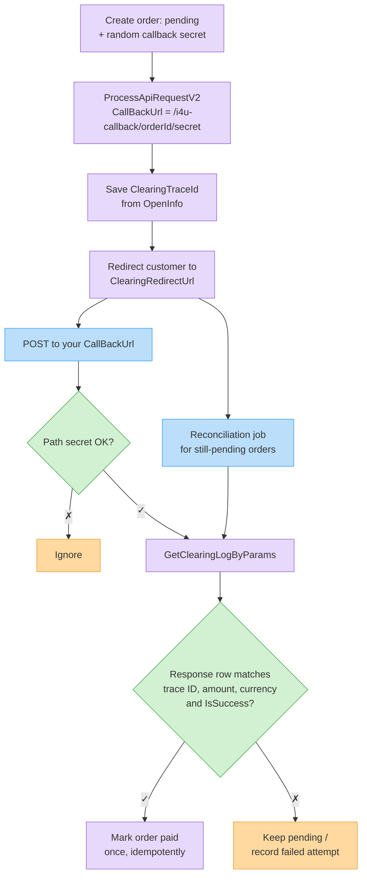

# Payment Callbacks: Verify, Confirm & Reconcile

This page answers the questions we get most often about `CallBackUrl` for hosted-page charges ([`ProcessApiRequestV2`](process-api-request-v2.md)): can you confirm an order from it, how do you verify it, and what happens if your server misses it.


This page covers the **hosted-page** callback (`CallBackUrl`). Recurring standing-order charges use a different callback with a different format — see [Standing Orders](standing-orders.md#callbacks-which-one-when-and-what).


## Quick answers

| Question | Answer |
| -------- | ------ |
| Can I confirm an order from the callback? | **Yes — after you verify it against the API.** The callback is the trigger; the [clearing-log](clearing-logs.md) lookup is the proof. Never confirm from the callback body alone, and never from the `ReturnUrl` redirect. |
| How do I verify the sender? | The callback is **not signed** — there's no signature, secret or auth header, and the source IP and headers aren't an authentication mechanism. Verify the **payment** instead: look it up with [`GetClearingLogByParams`](clearing-logs.md#search-getclearinglogbyparams) using your own API token. Only real charges on your organization are returned. |
| How do I verify the payment status? | In the clearing log, find the **response row** (`LogType` `2`) with `IsSuccess: true`, the callback's `PaymentId`, the `ClearingTraceId` you saved when you created the page, and the expected `Amount` and currency. |
| Are callbacks retried? | **No.** Each callback is sent **once**. Your response code and body are ignored. If your server is down, slow or errors, that notification is lost — Invoice4U does not retry and does not queue it. |
| So what do I do about missed callbacks? | Run a **reconciliation job** that checks pending orders against the clearing logs. Then a missed callback only delays confirmation; it doesn't lose the order. |

## The recommended flow



1. **Before** calling `ProcessApiRequestV2`, create the order as **pending** and generate a random, URL-safe secret for it (e.g. 32 hex characters).
2. Send `CallBackUrl` with the order ID and the secret **in the path** — for example `https://shop.example/api/i4u-callback/10045/9f2c…e1` — and send your order reference in `OrderIdClientUsage`.
3. From the response's `OpenInfo`, save `ClearingTraceId` on the order. This is the value that ties a payment to **this** order.
4. When the callback arrives, check the path secret, then [verify the payment](#verifying-a-callback) through the API. Confirm the order only if verification passes.
5. In parallel, a [reconciliation job](#reconciliation-when-no-callback-arrives) confirms pending orders whose callback never arrived.


**Don't put identifiers in the query string of `CallBackUrl`.** Depending on the provider, query-string parameters may be dropped or truncated on the way back. Put everything you need into the **path**.


## Delivery rules

* **One attempt, no retries.** The callback is posted once, in the background, after Invoice4U has processed the provider's result. There is no retry, no queue and no "resend" option.
* **Your response is ignored.** Return `200` quickly anyway; do heavy work (emails, fulfilment) asynchronously.
* **Not signed.** There is no signature, shared secret or authentication header. Don't rely on the source IP, `User-Agent` or other headers.
* **Not guaranteed to arrive.** Besides your own downtime, depending on the provider the callback may only be sent after the customer returns from the payment page — if they close the tab right after paying, no callback is sent even though the charge may have succeeded. This is why [reconciliation](#reconciliation-when-no-callback-arrives) is required, not optional.
* **Duplicates are possible in principle.** Make processing idempotent: a payment (`PaymentId`) may confirm an order at most once.
* **Failure callbacks are short.** A failed charge may be reported as a minimal object such as `{ "Success": "False", "ErrorMessage": "…", "ErrorId": "…", "PaymentId": "…", "CustomerName": "…" }` — **without** `OrderIdClientUsage` or `ClearingTraceId`. The order ID in your callback **path** is how you match these.
* **A failure isn't necessarily final for the order.** Record the failed attempt, but keep the order payable: a later success callback (or reconciliation hit) for the same order must still be honored.
* **HTTPS:** your endpoint must support TLS 1.2.

## Reading the callback body

The request body is the literal text `Data=` followed by the JSON object described in [Callback payload](process-api-request-v2.md#callback-payload). Although the `Content-Type` is `application/x-www-form-urlencoded`, the JSON is **not** URL-encoded.

Read the **raw body**, strip the leading `Data=`, and JSON-parse the rest. Don't let a form parser read it: values containing `+`, `&` or `%` (names, emails, the URL-encoded `CipherText`) get corrupted by form decoding. The JSON may be pretty-printed over several lines; any JSON parser handles that. All values are strings (`"True"`/`"False"` for booleans).

## Verifying a callback

The callback only tells you *something happened*. Before confirming the order:

1. **Check the path.** Look up the order by the ID in the path and compare the path secret with the stored one (constant-time compare). Unknown order or wrong secret → ignore. This filters noise; it's not the proof.
2. **Skip if already paid.** If the order is already confirmed, stop (idempotency).
3. **Read `Success`.** If it isn't `"True"`, record the failed attempt and stop. Don't confirm.
4. **Look the payment up** with [`GetClearingLogByParams`](clearing-logs.md#search-getclearinglogbyparams), filtering by the callback's `PaymentId`:

   ```http
   POST /Services/ApiService.svc/GetClearingLogByParams HTTP/1.1
   Host: api.invoice4u.co.il
   Content-Type: application/json

   {
     "searchParams": { "PaymentId": "100200300", "IsSuccess": true },
     "token": "<your API token>"
   }
   ```

   Call this from your server with your own token — results are always scoped to your organization, so a row that comes back is a real charge on your account.
5. **Match the row** — confirm the order only if a returned row has **all** of:

   | Check | Why |
   | ----- | --- |
   | `LogType` = `2` | Response row. The **request** row (`LogType` `1`) is written when the page is created and can show `IsSuccess: true` before anyone pays — never accept it. |
   | `IsSuccess` = `true` | The charge succeeded. |
   | `ClearingTraceId` = the value you saved for this order | Ties the payment to **this** order, so a real `PaymentId` from another (e.g. cheaper) order can't confirm it. |
   | `Amount` = the order total, `CurrencyName` = the order currency | The customer paid what you expect. |
   | `IsCredit` = `false` | Not a refund row. |

6. **Confirm once.** Mark the order paid and store the `PaymentId` (you'll need it for [refunds](process-api-request-v2.md#refunds)). Use a unique constraint or a conditional update so a duplicate callback, or the reconciliation job running at the same moment, can't confirm it twice.

If the lookup fails (timeout, dropped connection, empty result right after the callback), **don't** mark the order failed — leave it pending and let reconciliation retry. `GetClearingLogByParams` closes the connection instead of returning an error on an invalid token (see [Clearing Logs → Errors](clearing-logs.md#errors)), so treat a dropped connection as "unknown", not "not paid".


**Never confirm from the `ReturnUrl` redirect.** The customer's browser lands on `ReturnUrl` with parameters such as `?success=true&orderIdClientUsage=…`. Anyone can type that URL. Use `ReturnUrl` only to show a "thank you / processing" page, and confirm through the verified callback or reconciliation.


### Example handler



```javascript
const crypto = require('crypto');
const I4U = 'https://api.invoice4u.co.il/Services/ApiService.svc';

app.post('/api/i4u-callback/:orderId/:secret', express.text({ type: '*/*' }), async (req, res) => {
  res.sendStatus(200); // Invoice4U ignores the response — answer fast

  const order = await orders.find(req.params.orderId);
  if (!order || !safeEqual(order.callbackSecret, req.params.secret) || order.status === 'paid') return;

  const raw = req.body.trim();
  const evt = JSON.parse(raw.startsWith('Data=') ? raw.slice(5) : raw);
  if (evt.Success !== 'True') return orders.recordFailedAttempt(order.id, evt.ErrorMessage);

  await verifyAndConfirm(order, { PaymentId: evt.PaymentId, IsSuccess: true });
});

async function verifyAndConfirm(order, searchParams) {
  const r = await fetch(`${I4U}/GetClearingLogByParams`, {
    method: 'POST',
    headers: { 'Content-Type': 'application/json' },
    body: JSON.stringify({ searchParams, token: process.env.I4U_TOKEN }),
  });
  const rows = (await r.json()).d || [];
  const row = rows.find(l =>
    l.LogType === 2 && l.IsSuccess && !l.IsCredit &&
    l.ClearingTraceId === order.clearingTraceId &&
    Math.abs(l.Amount - order.total) < 0.005 &&
    l.CurrencyName === order.currency);
  if (row) await orders.markPaidOnce(order.id, row.PaymentId); // conditional update: WHERE status = 'pending'
}

function safeEqual(a, b) {
  const x = Buffer.from(String(a)), y = Buffer.from(String(b));
  return x.length === y.length && crypto.timingSafeEqual(x, y);
}
```



```php
<?php
// Route: POST /api/i4u-callback/{orderId}/{secret}
http_response_code(200); // Invoice4U ignores the response

$order = findOrder($orderId);
if (!$order || !hash_equals($order['callback_secret'], $secret) || $order['status'] === 'paid') exit;

$raw = trim(file_get_contents('php://input'));   // not $_POST
if (str_starts_with($raw, 'Data=')) $raw = substr($raw, 5);
$evt = json_decode($raw, true);

if (($evt['Success'] ?? '') !== 'True') { recordFailedAttempt($order['id'], $evt['ErrorMessage'] ?? ''); exit; }

$ch = curl_init('https://api.invoice4u.co.il/Services/ApiService.svc/GetClearingLogByParams');
curl_setopt_array($ch, [
    CURLOPT_POST => true,
    CURLOPT_RETURNTRANSFER => true,
    CURLOPT_HTTPHEADER => ['Content-Type: application/json'],
    CURLOPT_POSTFIELDS => json_encode([
        'searchParams' => ['PaymentId' => $evt['PaymentId'], 'IsSuccess' => true],
        'token' => getenv('I4U_TOKEN'),
    ]),
]);
$rows = json_decode(curl_exec($ch), true)['d'] ?? [];

foreach ($rows as $l) {
    if ($l['LogType'] === 2 && $l['IsSuccess'] && !$l['IsCredit']
        && $l['ClearingTraceId'] === $order['clearing_trace_id']
        && abs($l['Amount'] - $order['total']) < 0.005
        && $l['CurrencyName'] === $order['currency']) {
        markPaidOnce($order['id'], $l['PaymentId']); // UPDATE … WHERE status = 'pending'
        break;
    }
}
```



```csharp
app.MapPost("/api/i4u-callback/{orderId}/{secret}", async (string orderId, string secret, HttpRequest req, IHttpClientFactory http) =>
{
    var order = await Orders.FindAsync(orderId);
    if (order is null || order.Status == "paid" ||
        !CryptographicOperations.FixedTimeEquals(Encoding.UTF8.GetBytes(order.CallbackSecret), Encoding.UTF8.GetBytes(secret)))
        return Results.Ok();

    using var reader = new StreamReader(req.Body);
    var raw = (await reader.ReadToEndAsync()).Trim();
    if (raw.StartsWith("Data=")) raw = raw[5..];
    var evt = JsonSerializer.Deserialize<Dictionary<string, string>>(raw)!;

    if (evt.GetValueOrDefault("Success") != "True")
    {
        await Orders.RecordFailedAttemptAsync(order.Id, evt.GetValueOrDefault("ErrorMessage"));
        return Results.Ok();
    }

    var resp = await http.CreateClient().PostAsJsonAsync(
        "https://api.invoice4u.co.il/Services/ApiService.svc/GetClearingLogByParams",
        new { searchParams = new { PaymentId = evt["PaymentId"], IsSuccess = true }, token = Config.I4UToken });
    var rows = (await resp.Content.ReadFromJsonAsync<JsonElement>()).GetProperty("d");

    foreach (var l in rows.EnumerateArray())
    {
        if (l.GetProperty("LogType").GetInt32() == 2 && l.GetProperty("IsSuccess").GetBoolean()
            && !l.GetProperty("IsCredit").GetBoolean()
            && l.GetProperty("ClearingTraceId").GetString() == order.ClearingTraceId
            && Math.Abs(l.GetProperty("Amount").GetDouble() - order.Total) < 0.005
            && l.GetProperty("CurrencyName").GetString() == order.Currency)
        {
            await Orders.MarkPaidOnceAsync(order.Id, l.GetProperty("PaymentId").GetString()); // WHERE Status = 'pending'
            break;
        }
    }
    return Results.Ok();
});
```



## Reconciliation when no callback arrives

Because callbacks are not retried, run a scheduled job — for example every 5–10 minutes — over orders that are still **pending** a few minutes after the customer was sent to the payment page:

1. Call [`GetClearingLogByParams`](clearing-logs.md#search-getclearinglogbyparams) with a date range covering the pending orders (`FromDate` a little before the oldest one was created, `ToDate` now). `ClearingTraceId` isn't a search filter, so filter the results yourself.
2. For each pending order, look for a row with `LogType` `2`, `IsSuccess: true` and the order's saved `ClearingTraceId`, then apply the same [checks](#verifying-a-callback) (`Amount`, currency, `IsCredit`).
3. Match found → confirm the order (idempotently, as above). No successful match yet → keep the order pending and check again on the next run.
4. Still no successful match after your timeout (e.g. 24 hours) → mark the order **abandoned/expired** and release stock.

```json
{
  "searchParams": {
    "FromDate": "/Date(1788210000000+0300)/",
    "ToDate": "/Date(1788213600000+0300)/",
    "IsSuccess": true
  },
  "token": "<your API token>"
}
```

If a customer says they paid but there's still no matching response row after your timeout, check the transaction in your clearing provider's terminal before refunding or re-charging, and contact Invoice4U support with the order's `ClearingTraceId`.

## Checklist

* [ ] Order created as pending **before** calling `ProcessApiRequestV2`; `ClearingTraceId` from `OpenInfo` saved on it.
* [ ] `CallBackUrl` over HTTPS, with order ID + random secret in the **path** (no query string).
* [ ] Raw body read, `Data=` stripped, JSON parsed — no form parser.
* [ ] Order confirmed only after `GetClearingLogByParams` returns a `LogType` `2` row matching trace ID, amount, currency and `IsSuccess`.
* [ ] Confirmation is idempotent (one `PaymentId` → at most one order, one order → confirmed once).
* [ ] Reconciliation job covers missed callbacks; pending orders expire after a timeout.
* [ ] `ReturnUrl` used for display only.

## Related

* [Process a Clearing Request (V2)](process-api-request-v2.md) — request fields and the [callback payload](process-api-request-v2.md#callback-payload).
* [Clearing Logs](clearing-logs.md) — the `ClearingLog` object and search filters.
* [Standing Orders](standing-orders.md#callbacks-which-one-when-and-what) — recurring-charge callbacks.
