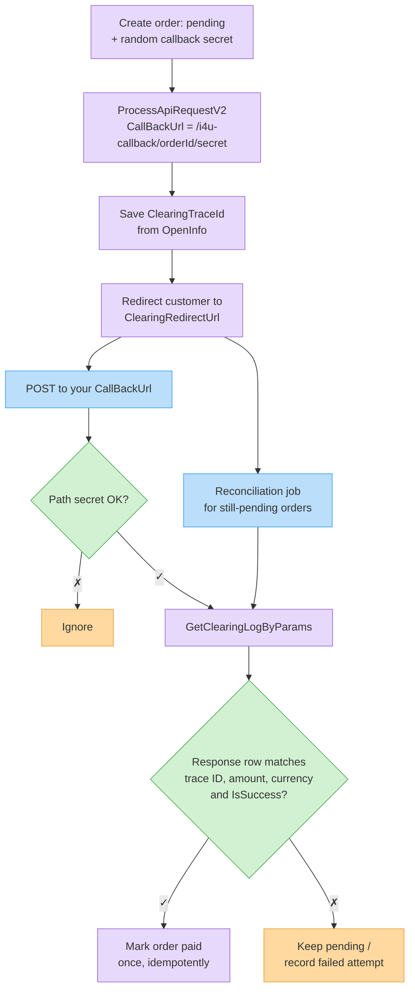

# ‫קולבק תשלום: אימות, אישור הזמנה והתאמה‬

‫העמוד הזה עונה על השאלות הנפוצות ביותר לגבי `CallBackUrl` בחיובים דרך דף סליקה מתארח ([`ProcessApiRequestV2`](process-api-request-v2.md)): האם אפשר לאשר הזמנה על סמך הקולבק, איך מאמתים אותו, ומה קורה אם השרת שלכם פספס אותו.‬


‫העמוד עוסק בקולבק של **דף הסליקה** (`CallBackUrl`). חיובים חוזרים של הוראות קבע משתמשים בקולבק אחר ובפורמט אחר — ראו [הוראות קבע](standing-orders.md#callbacks-which-one-when-and-what).‬


## ‫תשובות קצרות‬ {#quick-answers}

| ‫שאלה‬ | ‫תשובה‬ |
| -------- | ------ |
| ‫האם אפשר להסתמך על הקולבק לאישור הזמנה?‬ | ‫**כן — אחרי שאימתתם אותו מול ה-API.** הקולבק הוא הטריגר; החיפוש ב[לוגי הסליקה](clearing-logs.md) הוא ההוכחה. לעולם אל תאשרו הזמנה רק לפי גוף הקולבק, ולעולם לא לפי ההפניה ל-`ReturnUrl`.‬ |
| ‫איך מאמתים את מקור ההודעה?‬ | ‫הקולבק **אינו חתום** — אין חתימה, אין סוד משותף ואין כותרת אימות, וכתובת ה-IP והכותרות אינן מנגנון אימות. אמתו את **התשלום** עצמו: חפשו אותו ב-[`GetClearingLogByParams`](clearing-logs.md#search-getclearinglogbyparams) עם טוקן ה-API שלכם. מוחזרים רק חיובים אמיתיים של הארגון שלכם.‬ |
| ‫איך מאמתים את סטטוס התשלום?‬ | ‫בלוג הסליקה, מצאו את **שורת התשובה** (`LogType` `2`) עם `IsSuccess: true`, ה-`PaymentId` מהקולבק, ה-`ClearingTraceId` ששמרתם כשיצרתם את הדף, והסכום והמטבע הצפויים.‬ |
| ‫האם יש ניסיונות שליחה חוזרים?‬ | ‫**לא.** כל קולבק נשלח **פעם אחת**. קוד הסטטוס וגוף התשובה שלכם לא נבדקים. אם השרת שלכם לא זמין, איטי או מחזיר שגיאה — ההודעה אובדת. Invoice4U לא שולח שוב ולא שומר אותה בתור.‬ |
| ‫אז מה עושים עם קולבקים שפוספסו?‬ | ‫מריצים **תהליך התאמה (reconciliation)** שבודק הזמנות ממתינות מול לוגי הסליקה. כך קולבק שפוספס רק מעכב את האישור, ולא מאבד את ההזמנה.‬ |

## ‫התהליך המומלץ‬ {#the-recommended-flow}



1. ‫**לפני** הקריאה ל-`ProcessApiRequestV2`, צרו את ההזמנה בסטטוס **ממתין** וצרו עבורה סוד אקראי שבטוח לשימוש ב-URL (למשל 32 תווי hex).‬
2. ‫שלחו `CallBackUrl` שמכיל את מזהה ההזמנה ואת הסוד **בנתיב (path)** — למשל `https://shop.example/api/i4u-callback/10045/9f2c…e1` — ושלחו את מזהה ההזמנה שלכם גם ב-`OrderIdClientUsage`.‬
3. ‫מתוך `OpenInfo` בתשובה, שמרו את `ClearingTraceId` על ההזמנה. זה הערך שקושר תשלום ל**הזמנה הזו**.‬
4. ‫כשמגיע קולבק, בדקו את הסוד שבנתיב, ואז [אמתו את התשלום](#verifying-a-callback) מול ה-API. אשרו את ההזמנה רק אם האימות עבר.‬
5. ‫במקביל, [תהליך התאמה](#reconciliation-when-no-callback-arrives) מאשר הזמנות ממתינות שהקולבק שלהן לא הגיע.‬


‫**אל תשימו מזהים ב-query string של `CallBackUrl`.** בהתאם לספק הסליקה, פרמטרים ב-query string עלולים להישמט או להיחתך בדרך חזרה. שימו את כל מה שאתם צריכים ב**נתיב**.‬


## ‫כללי שליחה‬ {#delivery-rules}

* ‫**ניסיון אחד, בלי ניסיונות חוזרים.** הקולבק נשלח פעם אחת, ברקע, אחרי ש-Invoice4U עיבד את התוצאה מספק הסליקה. אין ניסיון חוזר, אין תור ואין אפשרות "שלח שוב".‬
* ‫**התשובה שלכם לא נבדקת.** בכל זאת החזירו `200` מהר, ובצעו עבודה כבדה (מיילים, אספקה) באופן אסינכרוני.‬
* ‫**לא חתום.** אין חתימה, אין סוד משותף ואין כותרת אימות. אל תסתמכו על כתובת ה-IP, על `User-Agent` או על כותרות אחרות.‬
* ‫**ההגעה לא מובטחת.** מלבד זמני השבתה אצלכם, בהתאם לספק הסליקה ייתכן שהקולבק נשלח רק אחרי שהלקוח חוזר מדף התשלום — אם הלקוח סוגר את הלשונית מיד אחרי התשלום, לא יישלח קולבק למרות שהחיוב אולי הצליח. לכן [ההתאמה](#reconciliation-when-no-callback-arrives) היא חובה, לא אופציה.‬
* ‫**כפילויות אפשריות עקרונית.** הפכו את העיבוד ל-idempotent: תשלום (`PaymentId`) יכול לאשר הזמנה לכל היותר פעם אחת.‬
* ‫**קולבק כישלון הוא קצר.** חיוב שנכשל עשוי להגיע כאובייקט מינימלי כמו `{ "Success": "False", "ErrorMessage": "…", "ErrorId": "…", "PaymentId": "…", "CustomerName": "…" }` — **בלי** `OrderIdClientUsage` ובלי `ClearingTraceId`. מזהה ההזמנה ב**נתיב** הקולבק הוא הדרך לשייך אותו להזמנה.‬
* ‫**כישלון אינו בהכרח סופי עבור ההזמנה.** תעדו את הניסיון שנכשל, אבל השאירו את ההזמנה פתוחה לתשלום: קולבק הצלחה מאוחר יותר (או התאמה שנמצאה) לאותה הזמנה חייב עדיין להתקבל.‬
* ‫**HTTPS:** ה-endpoint שלכם חייב לתמוך ב-TLS 1.2.‬

## ‫קריאת גוף הקולבק‬ {#reading-the-callback-body}

‫גוף הבקשה הוא הטקסט `Data=` ומיד אחריו אובייקט ה-JSON שמתואר ב[גוף הקולבק](process-api-request-v2.md#callback-payload). למרות שה-`Content-Type` הוא `application/x-www-form-urlencoded`, ה-JSON **אינו** מקודד URL.‬

‫קראו את **גוף הבקשה הגולמי**, הסירו את `Data=` שבהתחלה, ופענחו את השאר כ-JSON. אל תתנו ל-form parser לקרוא אותו: ערכים שמכילים `+`, `&` או `%` (שמות, מיילים, ה-`CipherText` המקודד ב-URL) משתבשים בפענוח טופס. ה-JSON עשוי להיות מפורמט על פני כמה שורות; כל מפענח JSON מתמודד עם זה. כל הערכים הם מחרוזות (`"True"`/`"False"` עבור בוליאנים).‬

## ‫אימות קולבק‬ {#verifying-a-callback}

‫הקולבק רק אומר לכם ש*משהו קרה*. לפני אישור ההזמנה:‬

1. ‫**בדקו את הנתיב.** אתרו את ההזמנה לפי המזהה שבנתיב והשוו את הסוד שבנתיב לסוד השמור (השוואה ב-constant time). הזמנה לא מוכרת או סוד שגוי ← התעלמו. זה מסנן רעש; זו לא ההוכחה.‬
2. ‫**דלגו אם כבר שולם.** אם ההזמנה כבר אושרה — עצרו (idempotency).‬
3. ‫**קראו את `Success`.** אם הוא לא `"True"`, תעדו את הניסיון שנכשל ועצרו. אל תאשרו.‬
4. ‫**חפשו את התשלום** ב-[`GetClearingLogByParams`](clearing-logs.md#search-getclearinglogbyparams), עם פילטר לפי ה-`PaymentId` מהקולבק:‬

   ```http
   POST /Services/ApiService.svc/GetClearingLogByParams HTTP/1.1
   Host: api.invoice4u.co.il
   Content-Type: application/json

   {
     "searchParams": { "PaymentId": "100200300", "IsSuccess": true },
     "token": "<your API token>"
   }
   ```

   ‫קראו לזה מהשרת שלכם עם הטוקן שלכם — התוצאות תמיד מוגבלות לארגון שלכם, כך ששורה שחוזרת היא חיוב אמיתי בחשבון שלכם.‬
5. ‫**התאימו את השורה** — אשרו את ההזמנה רק אם שורה שחזרה עומדת ב**כל** התנאים:‬

   | ‫בדיקה‬ | ‫למה‬ |
   | ----- | --- |
   | ‫`LogType` = `2`‬ | ‫שורת תשובה. שורת **הבקשה** (`LogType` `1`) נכתבת כשהדף נוצר ויכולה להציג `IsSuccess: true` עוד לפני שמישהו שילם — לעולם אל תקבלו אותה.‬ |
   | ‫`IsSuccess` = `true`‬ | ‫החיוב הצליח.‬ |
   | ‫`ClearingTraceId` = הערך ששמרתם להזמנה הזו‬ | ‫קושר את התשלום ל**הזמנה הזו**, כך ש-`PaymentId` אמיתי מהזמנה אחרת (למשל זולה יותר) לא יוכל לאשר אותה.‬ |
   | ‫`Amount` = סכום ההזמנה, `CurrencyName` = מטבע ההזמנה‬ | ‫הלקוח שילם את מה שציפיתם.‬ |
   | ‫`IsCredit` = `false`‬ | ‫לא שורת זיכוי.‬ |

6. ‫**אשרו פעם אחת.** סמנו את ההזמנה כשולמה ושמרו את ה-`PaymentId` (תצטרכו אותו ל[זיכויים](process-api-request-v2.md#refunds)). השתמשו ב-unique constraint או בעדכון מותנה, כך שקולבק כפול, או תהליך ההתאמה שרץ באותו רגע, לא יאשרו אותה פעמיים.‬

‫אם החיפוש נכשל (timeout, חיבור שנותק, תוצאה ריקה מיד אחרי הקולבק), **אל** תסמנו את ההזמנה כנכשלה — השאירו אותה ממתינה ותנו לתהליך ההתאמה לנסות שוב. `GetClearingLogByParams` סוגר את החיבור במקום להחזיר שגיאה כשהטוקן לא תקין (ראו [לוגי סליקה ← שגיאות](clearing-logs.md#errors)), לכן התייחסו לחיבור שנותק כ"לא ידוע", לא כ"לא שולם".‬


‫**לעולם אל תאשרו הזמנה לפי ההפניה ל-`ReturnUrl`.** הדפדפן של הלקוח מגיע ל-`ReturnUrl` עם פרמטרים כמו `?success=true&orderIdClientUsage=…`. כל אחד יכול להקליד את הכתובת הזו. השתמשו ב-`ReturnUrl` רק כדי להציג דף "תודה / בעיבוד", ואשרו דרך קולבק מאומת או דרך תהליך ההתאמה.‬


### ‫דוגמת handler‬ {#example-handler}



```javascript
const crypto = require('crypto');
const I4U = 'https://api.invoice4u.co.il/Services/ApiService.svc';

app.post('/api/i4u-callback/:orderId/:secret', express.text({ type: '*/*' }), async (req, res) => {
  res.sendStatus(200); // Invoice4U ignores the response — answer fast

  const order = await orders.find(req.params.orderId);
  if (!order || !safeEqual(order.callbackSecret, req.params.secret) || order.status === 'paid') return;

  const raw = req.body.trim();
  const evt = JSON.parse(raw.startsWith('Data=') ? raw.slice(5) : raw);
  if (evt.Success !== 'True') return orders.recordFailedAttempt(order.id, evt.ErrorMessage);

  await verifyAndConfirm(order, { PaymentId: evt.PaymentId, IsSuccess: true });
});

async function verifyAndConfirm(order, searchParams) {
  const r = await fetch(`${I4U}/GetClearingLogByParams`, {
    method: 'POST',
    headers: { 'Content-Type': 'application/json' },
    body: JSON.stringify({ searchParams, token: process.env.I4U_TOKEN }),
  });
  const rows = (await r.json()).d || [];
  const row = rows.find(l =>
    l.LogType === 2 && l.IsSuccess && !l.IsCredit &&
    l.ClearingTraceId === order.clearingTraceId &&
    Math.abs(l.Amount - order.total) < 0.005 &&
    l.CurrencyName === order.currency);
  if (row) await orders.markPaidOnce(order.id, row.PaymentId); // conditional update: WHERE status = 'pending'
}

function safeEqual(a, b) {
  const x = Buffer.from(String(a)), y = Buffer.from(String(b));
  return x.length === y.length && crypto.timingSafeEqual(x, y);
}
```



```php
<?php
// Route: POST /api/i4u-callback/{orderId}/{secret}
http_response_code(200); // Invoice4U ignores the response

$order = findOrder($orderId);
if (!$order || !hash_equals($order['callback_secret'], $secret) || $order['status'] === 'paid') exit;

$raw = trim(file_get_contents('php://input'));   // not $_POST
if (str_starts_with($raw, 'Data=')) $raw = substr($raw, 5);
$evt = json_decode($raw, true);

if (($evt['Success'] ?? '') !== 'True') { recordFailedAttempt($order['id'], $evt['ErrorMessage'] ?? ''); exit; }

$ch = curl_init('https://api.invoice4u.co.il/Services/ApiService.svc/GetClearingLogByParams');
curl_setopt_array($ch, [
    CURLOPT_POST => true,
    CURLOPT_RETURNTRANSFER => true,
    CURLOPT_HTTPHEADER => ['Content-Type: application/json'],
    CURLOPT_POSTFIELDS => json_encode([
        'searchParams' => ['PaymentId' => $evt['PaymentId'], 'IsSuccess' => true],
        'token' => getenv('I4U_TOKEN'),
    ]),
]);
$rows = json_decode(curl_exec($ch), true)['d'] ?? [];

foreach ($rows as $l) {
    if ($l['LogType'] === 2 && $l['IsSuccess'] && !$l['IsCredit']
        && $l['ClearingTraceId'] === $order['clearing_trace_id']
        && abs($l['Amount'] - $order['total']) < 0.005
        && $l['CurrencyName'] === $order['currency']) {
        markPaidOnce($order['id'], $l['PaymentId']); // UPDATE … WHERE status = 'pending'
        break;
    }
}
```



```csharp
app.MapPost("/api/i4u-callback/{orderId}/{secret}", async (string orderId, string secret, HttpRequest req, IHttpClientFactory http) =>
{
    var order = await Orders.FindAsync(orderId);
    if (order is null || order.Status == "paid" ||
        !CryptographicOperations.FixedTimeEquals(Encoding.UTF8.GetBytes(order.CallbackSecret), Encoding.UTF8.GetBytes(secret)))
        return Results.Ok();

    using var reader = new StreamReader(req.Body);
    var raw = (await reader.ReadToEndAsync()).Trim();
    if (raw.StartsWith("Data=")) raw = raw[5..];
    var evt = JsonSerializer.Deserialize<Dictionary<string, string>>(raw)!;

    if (evt.GetValueOrDefault("Success") != "True")
    {
        await Orders.RecordFailedAttemptAsync(order.Id, evt.GetValueOrDefault("ErrorMessage"));
        return Results.Ok();
    }

    var resp = await http.CreateClient().PostAsJsonAsync(
        "https://api.invoice4u.co.il/Services/ApiService.svc/GetClearingLogByParams",
        new { searchParams = new { PaymentId = evt["PaymentId"], IsSuccess = true }, token = Config.I4UToken });
    var rows = (await resp.Content.ReadFromJsonAsync<JsonElement>()).GetProperty("d");

    foreach (var l in rows.EnumerateArray())
    {
        if (l.GetProperty("LogType").GetInt32() == 2 && l.GetProperty("IsSuccess").GetBoolean()
            && !l.GetProperty("IsCredit").GetBoolean()
            && l.GetProperty("ClearingTraceId").GetString() == order.ClearingTraceId
            && Math.Abs(l.GetProperty("Amount").GetDouble() - order.Total) < 0.005
            && l.GetProperty("CurrencyName").GetString() == order.Currency)
        {
            await Orders.MarkPaidOnceAsync(order.Id, l.GetProperty("PaymentId").GetString()); // WHERE Status = 'pending'
            break;
        }
    }
    return Results.Ok();
});
```



## ‫התאמה (reconciliation) כשלא מגיע קולבק‬ {#reconciliation-when-no-callback-arrives}

‫מכיוון שאין ניסיונות שליחה חוזרים, הריצו תהליך מתוזמן — למשל כל 5–10 דקות — על הזמנות שעדיין **ממתינות** כמה דקות אחרי שהלקוח נשלח לדף התשלום:‬

1. ‫קראו ל-[`GetClearingLogByParams`](clearing-logs.md#search-getclearinglogbyparams) עם טווח תאריכים שמכסה את ההזמנות הממתינות (`FromDate` קצת לפני יצירת הוותיקה שבהן, `ToDate` עכשיו). `ClearingTraceId` אינו פילטר חיפוש, אז סננו את התוצאות בעצמכם.‬
2. ‫לכל הזמנה ממתינה, חפשו שורה עם `LogType` `2`, `IsSuccess: true` וה-`ClearingTraceId` ששמרתם להזמנה, ואז הפעילו את אותן [בדיקות](#verifying-a-callback) (`Amount`, מטבע, `IsCredit`).‬
3. ‫נמצאה התאמה ← אשרו את ההזמנה (באופן idempotent, כמו למעלה). עדיין אין התאמה מוצלחת ← השאירו את ההזמנה ממתינה ובדקו שוב בהרצה הבאה.‬
4. ‫עדיין אין התאמה מוצלחת אחרי פרק הזמן שהגדרתם (למשל 24 שעות) ← סמנו את ההזמנה כ**נטושה/פגה** ושחררו מלאי.‬

```json
{
  "searchParams": {
    "FromDate": "/Date(1788210000000+0300)/",
    "ToDate": "/Date(1788213600000+0300)/",
    "IsSuccess": true
  },
  "token": "<your API token>"
}
```

‫אם לקוח טוען ששילם אבל אחרי פרק הזמן שהגדרתם עדיין אין שורת תשובה תואמת, בדקו את העסקה במסוף של ספק הסליקה לפני זיכוי או חיוב מחדש, ופנו לתמיכת Invoice4U עם ה-`ClearingTraceId` של ההזמנה.‬

## ‫רשימת בדיקה‬ {#checklist}

* [ ] ‫ההזמנה נוצרת כממתינה **לפני** הקריאה ל-`ProcessApiRequestV2`; ה-`ClearingTraceId` מתוך `OpenInfo` נשמר עליה.‬
* [ ] ‫`CallBackUrl` ב-HTTPS, עם מזהה הזמנה + סוד אקראי ב**נתיב** (בלי query string).‬
* [ ] ‫קריאת גוף גולמי, הסרת `Data=`, פענוח JSON — בלי form parser.‬
* [ ] ‫ההזמנה מאושרת רק אחרי ש-`GetClearingLogByParams` מחזיר שורה עם `LogType` `2` שתואמת trace ID, סכום, מטבע ו-`IsSuccess`.‬
* [ ] ‫האישור הוא idempotent (`PaymentId` אחד ← לכל היותר הזמנה אחת, הזמנה אחת ← מאושרת פעם אחת).‬
* [ ] ‫תהליך התאמה מכסה קולבקים שפוספסו; הזמנות ממתינות פגות אחרי פרק זמן.‬
* [ ] ‫`ReturnUrl` משמש לתצוגה בלבד.‬

## ‫קישורים קשורים‬ {#related}

* ‫[ביצוע בקשת סליקה (גרסה 2)](process-api-request-v2.md) — שדות הבקשה ו[גוף הקולבק](process-api-request-v2.md#callback-payload).‬
* ‫[לוגי סליקה](clearing-logs.md) — אובייקט ה-`ClearingLog` ופילטרי החיפוש.‬
* ‫[הוראות קבע](standing-orders.md#callbacks-which-one-when-and-what) — קולבקים של חיובים חוזרים.‬
